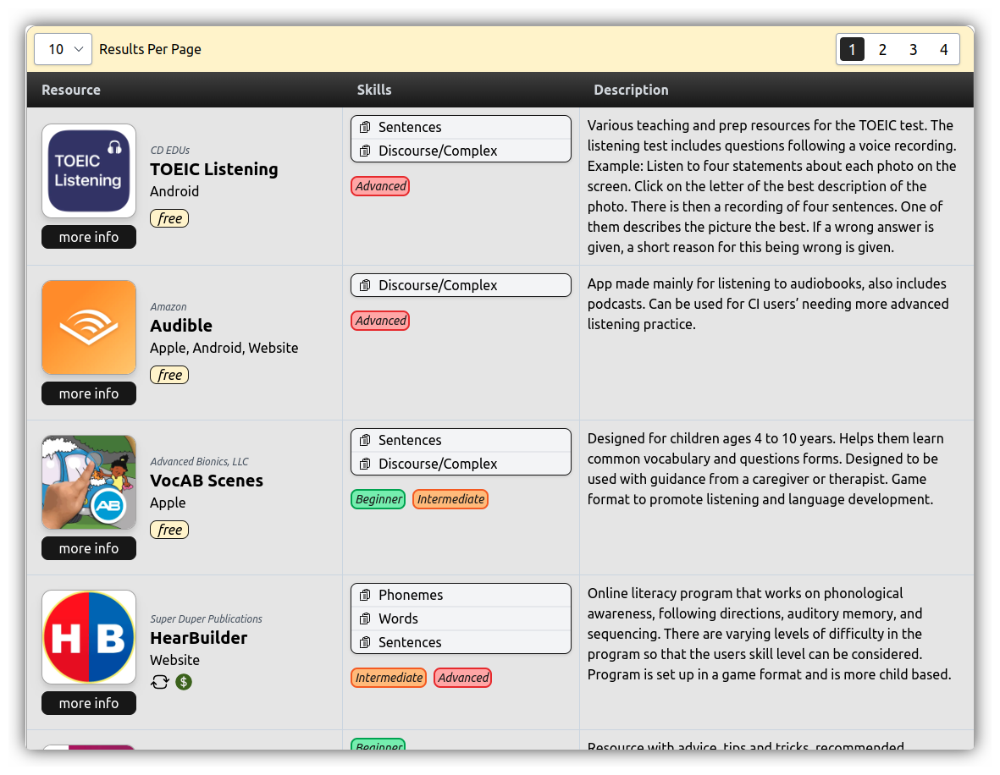

# Auditory Training Resources

<p align="center">
  
</p>

## Purpose

There are many auditory training resources that often have unique requirements. A patient may require an Android application, or help with a specific skill. The patient may also already be at a specific skill level, and want a resource that is more challenging or easier depending on age group. The goal of this application is to provide an accessible website for patients and providers to easily find recommendations for auditory training development resources based on their unique requirements.

## Production Deployment

### Docker Method

Currently this is being deployed through docker on a single VPS. Using the included docker-compose you can start the production server with the following command:

```sh
docker-compose up --build -d
```

This should deploy the instance on localhost:1234

I have this hosted behind a reverse proxy (nginx) which routes traffic from the auditorytraining.info URI to localhost:1234. You can of course change this to any port that works best in your configuration!

A more permanent hosting solution through the University is in the works.

## Directory Breakdown

Many directories have associated README's to provide related directory information.

- **_src/_** - source directory for nextjs frontend/backend application.
- **_data/_** - Non-application (application referring to excelProcessor or frontend) specific data such as the ATR data excel sheet which has multiple uses in each application.
- **_prisma/_** - Prisma schema and seeding of admin account (specified in env).
- **_excelProcessor/_** - Main excel processing backend server and CLI utility for uploading the ATR data excel sheet to MongoDB.
